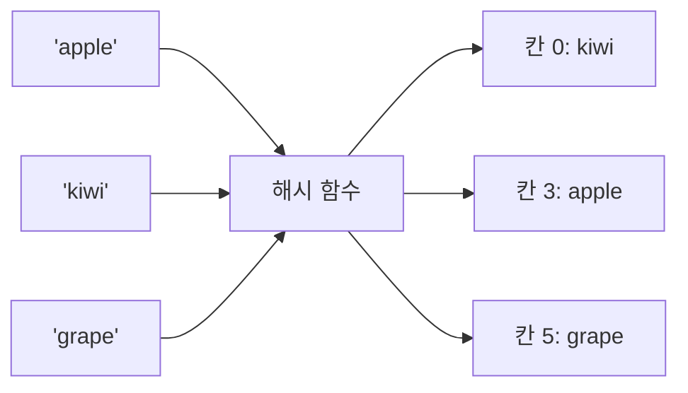

# 🔑 2. 해싱

> 출처: Notion "2026 프로그래밍과 문제해결"

# 1. 해싱

## 해싱이란?

- 데이터(키)를 해시 함수에 넣어서 나온 숫자를 "저장할 칸 번호"로 쓰는 방법
- 찾을 때도 같은 해시 함수로 칸 번호를 바로 계산해서 그 칸만 보면 됨 → 처음부터 끝까지 훑을 필요가 없음
- 비유: 사물함. 이름을 보면 몇 번 사물함인지 바로 계산되니까, 사물함 100개를 하나씩 열어볼 필요 없이 한 번에 찾아감



- 용어
  - 해시 함수: 키를 칸 번호(숫자)로 바꿔주는 함수
  - 해시 테이블: 칸 번호로 데이터를 저장해두는 표
  - 충돌: 서로 다른 키가 같은 칸 번호로 가는 경우. 파이썬이 알아서 처리해주므로 직접 신경 쓸 일은 거의 없음

## 왜 해싱을 쓰나

- 리스트에서 `x in l`은 앞에서부터 하나씩 비교 → O(n)
- set/dict에서 `x in s`는 칸 번호를 바로 계산 → 평균 O(1)
- 데이터 n개에 질문 q개가 들어오면
  - 리스트: O(n × q) → n, q가 10만이면 100억 번 → 시간 초과
  - set: O(n + q) → 20만 번 정도면 끝
- 결론: "있냐 없냐", "몇 번 나왔냐"를 반복해서 물어보는 문제는 거의 항상 해싱

## 파이썬에서의 해싱: set과 dict

- set: 값만 저장. 중복이 자동으로 사라짐. "있냐 없냐" 확인용
- dict: 키 → 값 쌍으로 저장. "이 키에 붙은 정보(개수 등)"를 찾을 때

### set 기본 코드

```py
a = set(input().split())    # 입력을 set으로 받기

a.add('x')                  # 추가
a.discard('x')              # 삭제 (없어도 에러 안 남)
print('x' in a)             # 있는지 확인 → True / False
print(len(a))               # 서로 다른 원소 개수
```

### dict 기본 코드

```py
m = {}
for i in input().split():
    m[i] = m.get(i, 0) + 1  # 개수 세기

print(m.get('x', 0))        # 키가 없으면 0
for k in m:                 # 키를 넣은 순서대로 순회
    print(k, m[k])
```

## 코드 설명

- `set(input().split())`: 공백으로 나눈 문자열 리스트를 set으로 바꿈. 같은 값은 하나만 남음
- `m.get(i, 0)`: 키 i가 있으면 그 값, 없으면 0. `m[i]`로 바로 꺼내면 키가 없을 때 KeyError
- `m[i] = m.get(i, 0) + 1`: "처음 보면 0에서 시작해서 +1, 본 적 있으면 기존 값 +1" → 개수 세기의 기본 패턴
- `for k in m`: dict는 키를 넣은 순서를 기억함 (파이썬 3.7 이상)

## 시간 복잡도

- set/dict의 추가, 삭제, `in` 확인: 평균 O(1)
- 리스트의 `in`: O(n)

## 주의할 점

- set에는 순서가 없음 → 출력 순서가 중요하면 set을 순회하지 말고, 원래 입력 리스트를 순회하면서 set으로 확인만 할 것
- 키로 쓸 수 있는 건 바뀌지 않는 값(숫자, 문자열, 튜플)만. 리스트는 키가 될 수 없음 → 좌표 같은 건 `(x, y)` 튜플로
- 입력을 `split()`만 하면 문자열 상태. "10"과 "010"을 같은 수로 봐야 하면 `int`로 바꿔서 넣을 것

# 2. 해싱의 활용

## 활용 ① 있는지 없는지 확인 (존재 여부)

- 어떤 상황에서 쓰나 : 목록 A가 주어지고, 질문으로 들어오는 값마다 A에 있는지 YES/NO로 답할 때
- 핵심 아이디어 : A를 set으로 만들어두면 질문 하나당 O(1)로 확인

```py
n, k = map(int, input().split())
a = set(input().split())
b = input().split()

for i in b:
    if i in a:
        print("YES")
    else:
        print("NO")
```

## 활용 ② 서로 다른 값의 개수 (중복 제거)

- 어떤 상황에서 쓰나 : 방문자 명단에서 실제 방문한 사람 수, 서로 다른 수가 몇 개인지
- 핵심 아이디어 : set은 중복을 자동으로 없애므로 `len(set(...))`이 곧 답

```py
n = input()
print(len(set(input().split())))
```

## 활용 ③ 한쪽에만 있는 값 찾기 (차집합)

- 어떤 상황에서 쓰나 : 등록 명단 A와 제출 목록 B가 있을 때, B 중에서 A에 없는(미등록) 것만 입력 순서대로 뽑기
- 핵심 아이디어 : A를 set으로 만들고, B는 리스트 그대로 순회하면서 `not in`인 것만 모음
  - `set(b) - a`로 차집합을 구하면 빠르지만 순서가 섞이고 중복도 사라짐 → 입력 순서를 지켜야 하면 리스트 순회

```py
n, k = map(int, input().split())
a = set(input().split())
b = input().split()

l = []
for i in b:
    if i not in a:
        l.append(i)

print(' '.join(l) if l else "NONE")
```

## 활용 ④ 빈도수 세기와 최빈값

- 어떤 상황에서 쓰나 : 가장 많이 나온 값과 그 횟수 (투표 결과, 가장 많이 팔린 상품)
- 핵심 아이디어 :
  - dict로 값마다 나온 횟수를 셈
  - 최댓값을 구한 뒤, 그 횟수를 가진 키 중 가장 먼저 나온 것을 답으로
  - dict는 넣은 순서 = 처음 등장한 순서를 기억하므로, dict를 앞에서부터 돌다가 처음 걸리는 게 "동률이면 먼저 나온 것"

```py
n = int(input())
k = input().split()

m = {}
for i in k:
    m[i] = m.get(i, 0) + 1

mx = max(m.values())
for i in m:
    if m[i] == mx:
        print(i, mx)
        break
```

- 입력 예: `b a b a c c c` → `c 3`, `b a a b` → `b 2` (동률이면 먼저 나온 b)
- 수정한 부분 : 원래는 답을 r에 저장해놓고 i를 출력했음 (break 직후라 값은 같아서 우연히 맞음). 입력 리스트 대신 dict를 바로 순회하도록 정리

## 활용 ⑤ 개수 질문에 답하기

- 어떤 상황에서 쓰나 : 카드 n장이 있을 때, 질문으로 들어온 숫자가 각각 몇 장 있는지
- 핵심 아이디어 : 미리 dict로 개수를 다 세어두고, 질문마다 `get(x, 0)`으로 바로 답함
  - 질문마다 `l.count(x)`를 쓰면 매번 O(n) → 질문이 많으면 시간 초과

```py
n = int(input())
k = input().split()

m = {}
for i in k:
    m[i] = m.get(i, 0) + 1

s = int(input())
l = input().split()
for i in l:
    print(m.get(i, 0))
```

## 활용 ⑥ 조건에 맞는 것만 세서 최빈값 (set + dict 조합)

- 어떤 상황에서 쓰나 : 후보 명단(set)에 있는 이름만 득표로 인정해서 1등 구하기. 유효한 표가 하나도 없으면 `NONE 0`
- 핵심 아이디어 :
  - set으로 "유효한가?"를 O(1)로 거르고
  - dict로 "몇 번 나왔나?"를 셈
  - 동률이면 먼저 나온 것 → dict 순회 순서 그대로

```py
n, m = map(int, input().split())
s = set(input().split())
l = input().split()

c = {}
for x in l:
    if x in s:
        c[x] = c.get(x, 0) + 1

if not c:
    print("NONE", 0)
else:
    mx = max(c.values())
    for x in c:
        if c[x] == mx:
            print(x, mx)
            break
```
